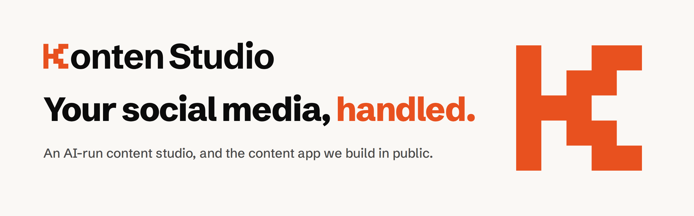

<a href="https://kontenstudio.agency">
  <picture>
    <source media="(prefers-color-scheme: dark)" srcset="banner-dark.png">
    
  </picture>
</a>

**Konten Studio** is an AI-run content studio. Our agents draft the posts in your voice, you OK them, and they go out on schedule. We build the app behind it in public. → [kontenstudio.agency](https://kontenstudio.agency)

### Open tools for agent users

| Repo | What it does |
|---|---|
| **[jekardah-writer](https://github.com/konten-studio/jekardah-writer)** | Portable AI writing workflow for hooks, anti-slop editing and a natural Jabodetabek voice |
| **[lizzard-writer](https://github.com/konten-studio/lizzard-writer)** | Lizard-brain content: danger or happy mode, then a payoff so simple people say "ternyata cuma gitu" |
| **[bipit](https://github.com/konten-studio/bipit)** | Turn your agent session into a build-in-public post |
| **[sniv-claude-plugin](https://github.com/konten-studio/sniv-claude-plugin)** | The sniv plugin for Claude: read a brand's public social media and get the one fix |

All of them are agent skills for Claude Code, Codex, opencode and any agent that reads `SKILL.md`.

### Talk to us

